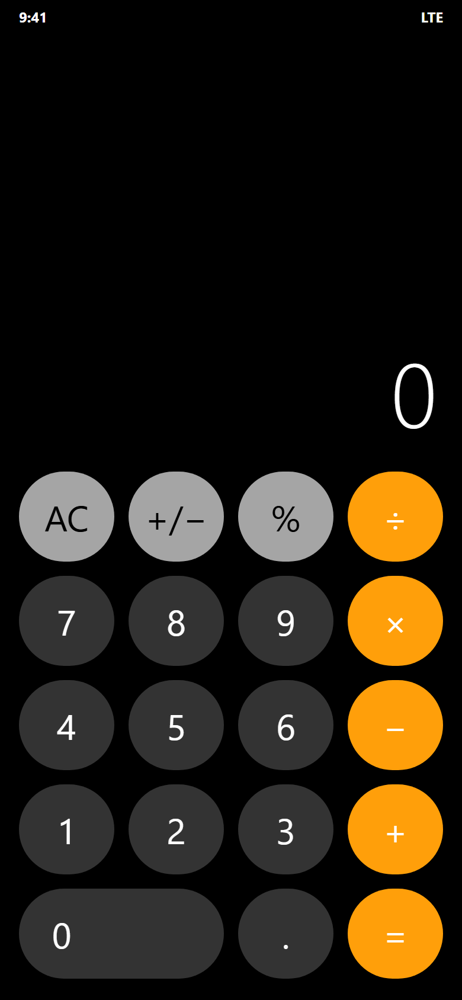
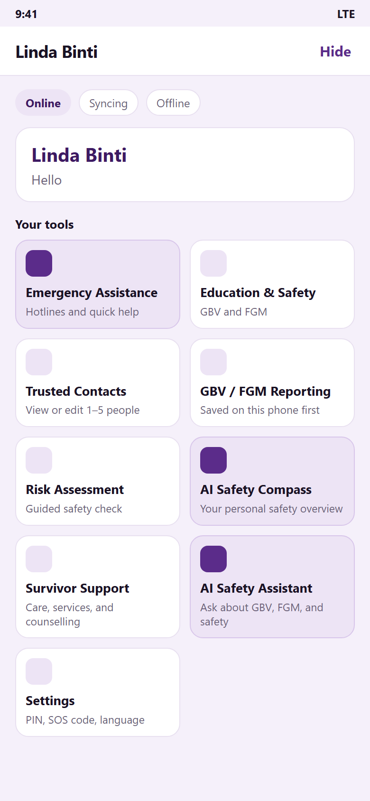
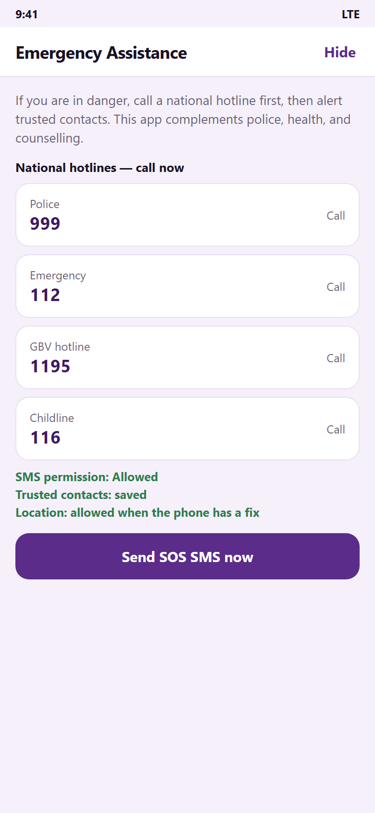
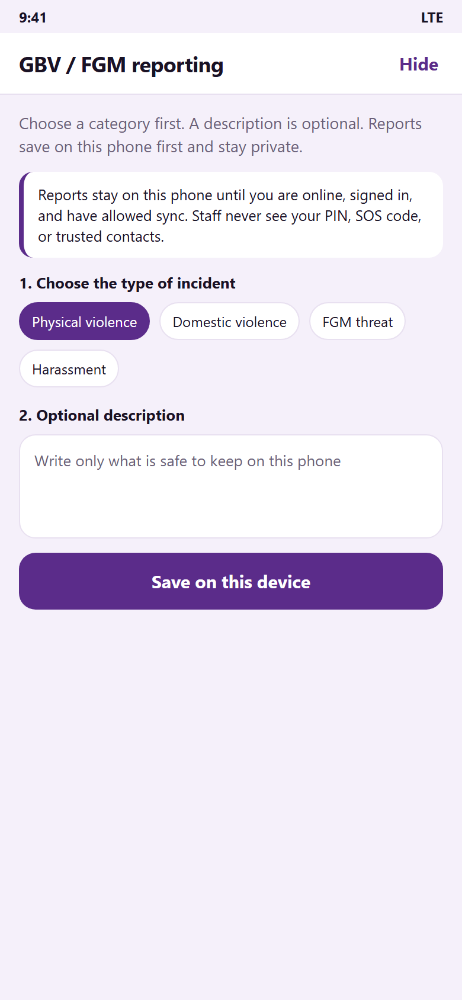
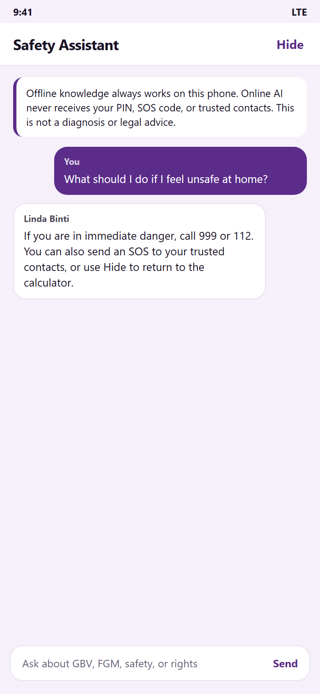
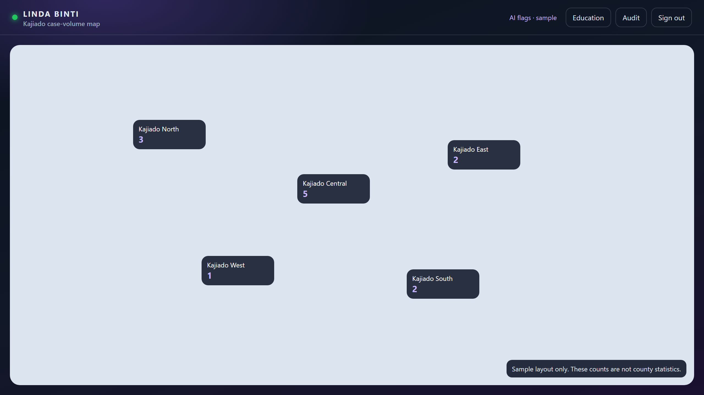

# 🇰🇪 Linda Binti

An Android and web platform for the prevention of, and response to, gender-based violence (GBV) and female genital mutilation (FGM) in Kajiado County, Kenya. Developed with Kotlin and Android Studio.

## About the Project

Linda Binti is a final-year Bachelor of Science in Information Technology project at Umma University. The phone application opens as a calculator. A private access code opens the safety tools. A separate SOS code sends an SMS to trusted contacts, including location when the phone can provide it. That alert does not need the internet.

The app supports survivors and authorised NGO staff. It complements the police, health workers, and counsellors. It does not replace 999, 112, 1195, or 116.

## Technologies Used

- Kotlin
- Android Studio
- Jetpack Compose
- Room and SQLite
- Ktor
- HTML, CSS, and JavaScript
- Gradle
- Git and GitHub

## Features

- Opens as a working calculator so the safety tools stay private.
- Sends an SOS by SMS to trusted contacts, without the internet.
- Saves a GBV or FGM report on the phone first.
- Includes safety education and a safety assistant that works offline.
- Gives authorised NGO staff a web dashboard and a Kajiado case-volume map.
- Includes screenshots to demonstrate the application.
- Source code available for learning and further development.

## Screenshots

The following screenshots demonstrate the Linda Binti application.

  <b>Calculator</b> &nbsp;&nbsp;&nbsp;
  <b>Home</b> &nbsp;&nbsp;&nbsp;
  <b>Emergency</b>

  
  
  

  <b>Reporting</b> &nbsp;&nbsp;&nbsp;
  <b>Safety Assistant</b> &nbsp;&nbsp;&nbsp;
  <b>NGO Dashboard</b>

  
  
  

## Download the App

Download the APK from the latest GitHub release:

**[Download Linda Binti v3.0.1](https://github.com/Qathra/Linda-Binti/releases/latest)**

1. Open the release page on your Android phone.
2. Download `Linda-Binti-3.0.1.apk`.
3. Open the downloaded file and follow Android's installation prompts.
4. The icon and the first screen are a calculator. Use your access code to open Linda Binti.

*Note: This package is for direct installation at a demonstration. It is not published on Google Play.*

## How to Run the Project

1. Clone or download this repository.
2. Open the project in Android Studio.
3. Allow Gradle to sync.
4. Connect an Android phone or start an emulator.
5. Run the app from Android Studio.
6. To run the NGO dashboard as well, start the backend with `.\gradlew :backend:run`, then open `http://127.0.0.1:8080/dashboard/`.

## Developer

**Qathra Hamdi Ahmed**

Bachelor of Science in Information Technology | Umma University | BSIT/2024/52344

## Project Status

Version: `v3.0.1`

This project is a working prototype, ready to demonstrate, and available for further development.

## Repository

[View Linda Binti on GitHub](https://github.com/Qathra/Linda-Binti)
